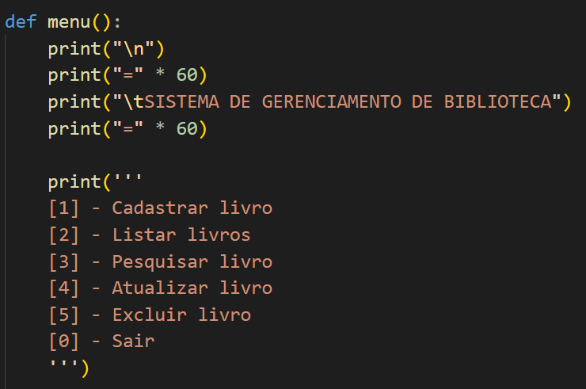
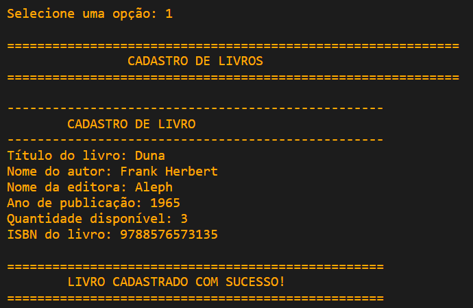
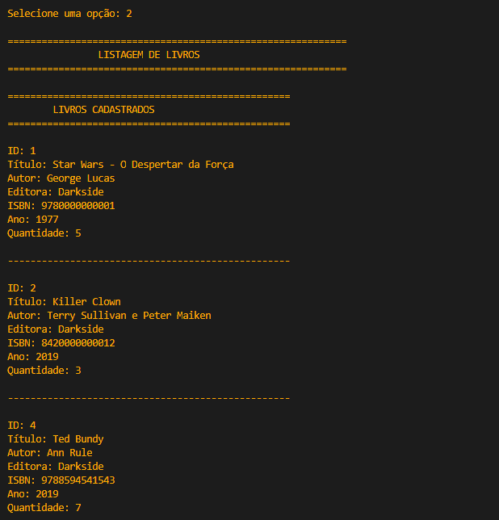
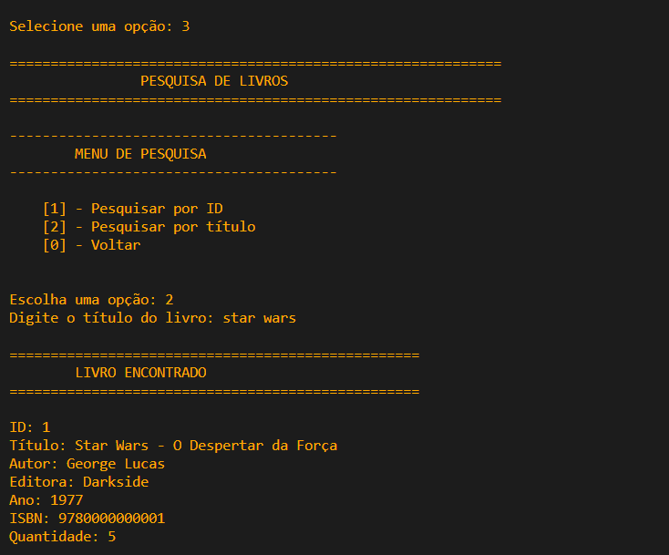
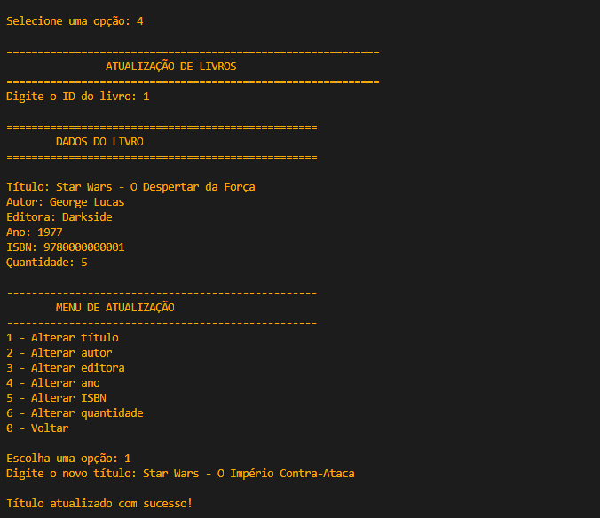
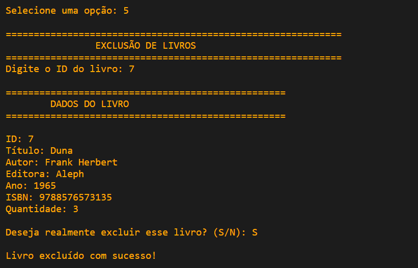
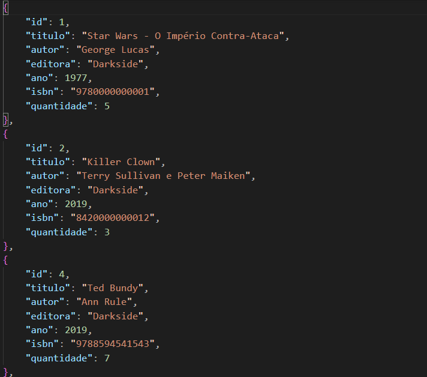

# Sistema de Gerenciamento de Biblioteca

Projeto desenvolvido em Python para a disciplina de Algoritmos.

## Descrição e objetivo

O Sistema de Gerenciamento de Biblioteca é uma aplicação desenvolvida em Python que permite organizar e gerenciar informações de livros cadastrados.

O objetivo do sistema é facilitar o controle dos livros por meio de operações de cadastro, consulta, atualização e exclusão de registros.

## Problema que o sistema busca resolver

O sistema busca solucionar a dificuldade de organizar e controlar informações de livros em uma biblioteca. A falta de organização pode dificultar a localização de livros, a consulta de informações e a atualização dos registros.

Com isso, a aplicação oferece uma forma simples de centralizar essas informações e facilitar o gerenciamento dos livros.

## Integrante

- Caio Gilberto Ribeiro Sá

## Tecnologias utilizadas

- **Python:** linguagem utilizada para desenvolver o sistema.
- **JSON:** formato utilizado para armazenar os dados dos livros.
- **Git:** ferramenta utilizada para controlar as versões do projeto.
- **GitHub:** plataforma utilizada para hospedar o repositório e registrar o histórico de desenvolvimento.
- **Visual Studio Code:** editor de código utilizado no desenvolvimento.

## Funcionalidades implementadas

- **Cadastrar livros:** permite adicionar novos livros à biblioteca.
- **Listar livros:** exibe todos os livros cadastrados.
- **Pesquisar livros:** permite localizar registros pelo ID ou pelo título.
- **Atualizar livros:** permite modificar as informações de um livro cadastrado.
- **Excluir livros:** permite remover um livro após confirmação do usuário.
- **Validação de dados:** verifica entradas inválidas, campos obrigatórios, ISBN duplicado, ano de publicação e quantidade.
- **Persistência de dados:** mantém os registros salvos no arquivo JSON, mesmo após o encerramento do programa.

## Instalação e execução

1. Instale o Python no computador.
2. Clone o repositório do projeto:
    
   git clone https://github.com/caioribg/sistema-biblioteca.git

3. Acesse a pasta do projeto:

   cd sistema-biblioteca

4. Execute o sistema pelo terminal:

   python main.py

## Armazenamento dos dados

Os dados dos livros são armazenados no arquivo `dados.json`, utilizando o formato JSON.

O Python utiliza o módulo `json` para realizar a leitura e a gravação dos registros:
- `json.load()`: carrega os dados do arquivo para o programa.
- `json.dump()`: grava os dados atualizados no arquivo.

Dessa forma, as informações permanecem salvas mesmo após o encerramento do sistema, permitindo que sejam recuperadas na próxima execução.

## Exemplos de utilização

Ao executar o sistema, o usuário encontra um menu principal com as seguintes opções:

[1] - Cadastrar livro;
[2] - Listar livros;
[3] - Pesquisar livro;
[4] - Atualizar livro;
[5] - Excluir livro;
[0] - Sair.

**Exemplo de cadastro:**

O usuário seleciona a opção 1 e informa os dados solicitados, como título, autor, editora, ano de publicação, ISBN e quantidade.

**Exemplo de pesquisa:**

O usuário seleciona a opção 3 e escolhe pesquisar por ID ou título para localizar um livro cadastrado.

**Exemplo de atualização e exclusão:**

O usuário seleciona a opção correspondente, informa o ID do livro e segue as instruções apresentadas pelo sistema.

## Demonstração do sistema

### Menu principal

### Cadastro de livros

### Listagem de livros

### Pesquisa de livros

### Atualização de livros

### Exclusão de livros

### Armazenamento dos dados (JSON)
